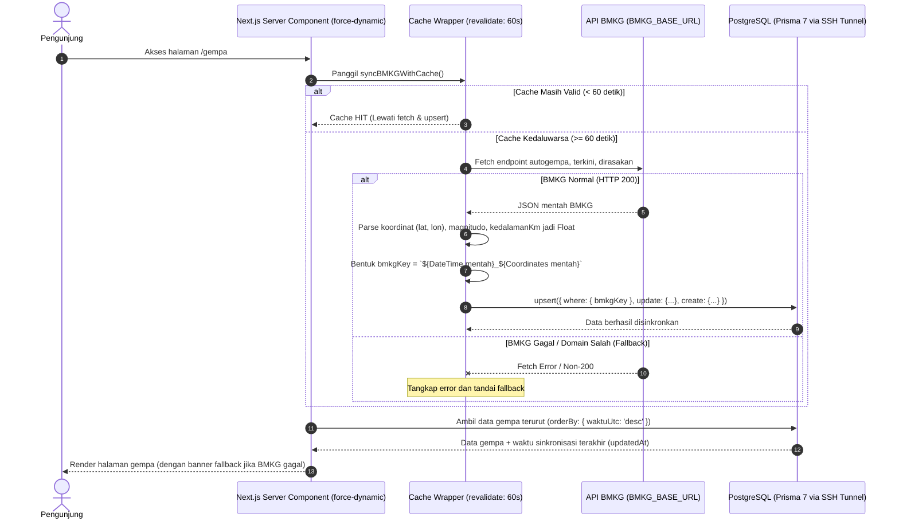

# Implementation Plan: Fondasi Database dan Data Gempa BMKG

**Branch**: `002-fondasi-database-gempa` | **Date**: 2026-10-15 | **Spec**: [specs/002-fondasi-database-gempa/spec.md](spec.md)

**Input**: Feature specification from `/specs/002-fondasi-database-gempa/spec.md`

---

## Summary

Mengimplementasikan fondasi persistensi data kebencanaan gempa bumi untuk SIGAP menggunakan Prisma 7.10.0 dan PostgreSQL 16 (pada VPS melalui SSH tunnel). Fitur ini mengintegrasikan 3 endpoint resmi BMKG (`autogempa.json`, `gempaterkini.json`, dan `gempadirasakan.json`), melakukan parsing dan transformasi data numerik (`lat`, `lon`, `magnitudo`, `kedalamanKm`), menerapkan deduplikasi berbasis kunci unik mentah BMKG `${DateTime}_${Coordinates}`, membungkus sinkronisasi dalam satu fungsi ber-cache (maksimal 1x per 60 detik), menyetel halaman `/gempa` dan `/gempa/[id]` menjadi dinamis (`force-dynamic`) agar build tidak memicu koneksi database, serta menyediakan mekanisme fallback otomatis ke data tersimpan di PostgreSQL ketika layanan BMKG sedang tidak dapat dijangkau.

---

## Technical Context

**Language/Version**: TypeScript 5.x (Strict Mode), Node.js 20+  
**Primary Dependencies**: Next.js 16.3.8 (App Router), React 19.2.8, React DOM 19.2.8, Prisma ORM 7.10.0, `@prisma/adapter-pg`, `pg`, `dotenv`, Tailwind CSS 4.x (`@tailwindcss/postcss`)  
**Storage**: PostgreSQL 16 (VPS Docker container, diakses di lingkungan pengembang lokal melalui SSH tunnel `localhost:5433`)  
**Testing**: Pengujian manual berbasis skenario end-to-end (lihat [quickstart.md](quickstart.md)) dan verifikasi integritas data via Prisma Studio  
**Target Platform**: Web application (Next.js Server Components di server Node.js)  
**Project Type**: Web Application kebencanaan publik  
**Performance Goals**: Waktu muat halaman `/gempa` < 3 detik (koneksi normal), penyajian fallback dari basis data < 1 detik saat BMKG gagal dijangkau  
**Constraints**: Tanpa Redis, tanpa background cron daemon (sinkronisasi on-demand dibungkus satu fungsi ber-cache revalidasi 60 detik), halaman `/gempa` dan `/gempa/[id]` disetel `force-dynamic` agar build tidak menyentuh database, driver adapter `@prisma/adapter-pg` wajib pada Prisma 7 untuk PostgreSQL, file `.env` tidak boleh di-commit  
**Scale/Scope**: Model data `Gempa` (kolom: `waktuUtc`, `lat`, `lon`, `magnitudo`, `kedalamanKm`, `updatedAt`, enum `StatusTsunami`, enum `JenisGempa`) dan `Berita` (fondasi), modul `lib/bmkg.ts`, route `api/gempa/route.ts`, halaman daftar `/gempa` dan halaman detail `/gempa/[id]`

---

## Constitution Check

*GATE: Evaluasi terhadap `.specify/memory/constitution.md`*

| Prinsip | Status | Analisis & Kepatuhan |
|---------|--------|----------------------|
| **I. Data-First: BMKG** | ✅ PASS | Seluruh data gempa bersumber dari BMKG melalui `src/lib/bmkg.ts`. Tidak ada pemanggilan API BMKG langsung dari client. Database bertindak sebagai layer persistensi dan fallback. |
| **II. Server-First Rendering** | ✅ PASS | Halaman `/gempa/page.tsx` dan `/gempa/[id]/page.tsx` diimplementasikan sebagai React Server Components (RSC) dengan `export const dynamic = 'force-dynamic'` agar `next build` tidak menyentuh database. |
| **III. TypeScript Strict** | ✅ PASS | Tidak ada penggunaan `any`. Semua tipe didefinisikan secara terpusat di `src/types/gempa.ts` dan tipe turunan Prisma Client (`waktuUtc`, `lat`, `lon`, `magnitudo`, `kedalamanKm`, enum `StatusTsunami`: `AMAN`, `BERPOTENSI`, `TIDAK_DINYATAKAN`). Explicit return types diterapkan di seluruh fungsi. |
| **IV. UI Berbahasa Indonesia** | ✅ PASS | Seluruh teks antarmuka, status tsunami, skala MMI, pesan peringatan, penanda waktu (WIB), dan keterangan fallback menggunakan Bahasa Indonesia. |
| **V. Komponen UI Reusable** | ✅ PASS | Menggunakan kembali komponen dasar di `src/components/ui/` (`Card`, `Badge`, `Skeleton`, `Tabs`) tanpa membuat komponen duplikat. |
| **VI. Prisma 7 + PostgreSQL** | ✅ PASS | Menggunakan Prisma 7.10.0 dengan singleton pattern di `src/lib/prisma.ts`. Schema didefinisikan di `prisma/schema.prisma`. Konfigurasi resmi di `prisma.config.ts` (menghapus `prisma7.config.ts`). Migrasi dikelola lewat `prisma migrate dev`. |
| **VII. Chatbot Gemini** | ✅ N/A | Di luar cakupan fitur ini. |

**Gate Result**: ✅ **PASSED** — Tidak ada pelanggaran terhadap constitution.

---

## Project Structure

### Documentation (Artifacts Fitur Ini)

```text
specs/002-fondasi-database-gempa/
├── spec.md              # Spesifikasi kebutuhan & kriteria keberhasilan
├── plan.md              # Rencana arsitektur dan implementasi teknis (berkas ini)
├── research.md          # Riset teknis Prisma 7, driver adapter, parsing BMKG
├── data-model.md        # Definisi skema Prisma, tipe entitas, validasi
├── quickstart.md        # Panduan penyiapan & skenario pengujian manual
├── contracts/
│   └── gempa-api.md     # Kontrak antarmuka internal & API Route
└── checklists/
    └── requirements.md  # Validasi kelengkapan spesifikasi
```

### Source Code (File yang Ditambah, Dihapus, atau Diperbarui)

```text
sigap/
├── prisma7.config.ts                     # [HAPUS] Dihapus karena Prisma CLI 7 menggunakan prisma.config.ts
├── prisma.config.ts                      # [BARU] Konfigurasi resmi Prisma 7 CLI & dotenv loader
├── prisma/
│   ├── schema.prisma                     # [UPDATE] Model Gempa (lat, lon, magnitudo, kedalamanKm, waktuUtc, StatusTsunami, JenisGempa) & Berita
│   └── migrations/                       # [BARU] SQL migrations dari prisma migrate dev (di-commit)
├── src/
│   ├── generated/prisma/                 # [AUTO] Prisma Client hasil generate (di-ignore Git)
│   ├── lib/
│   │   ├── prisma.ts                     # [BARU] Singleton Prisma Client dengan @prisma/adapter-pg
│   │   └── bmkg.ts                       # [UPDATE] Fetcher BMKG, wrapper cache sinkronisasi 60s, upsert ke PostgreSQL
│   ├── types/
│   │   └── gempa.ts                      # [UPDATE] Definisi TypeScript interface data BMKG & Domain
│   ├── components/
│   │   └── gempa/
│   │       ├── GempaCard.tsx             # [UPDATE] Kartu ringkasan gempa
│   │       ├── FilterBar.tsx             # [UPDATE] Tab switch kategori gempa (terbaru, M5+, dirasakan)
│   │       ├── GempaTable.tsx            # [UPDATE] Tabel riwayat gempa
│   │       ├── ShakemapImage.tsx         # [UPDATE] Penampil peta guncangan dengan fallback aman
│   │       └── StatCard.tsx              # [UPDATE] Statistik ringkas magnitudo/kedalaman
│   └── app/
│       ├── api/
│       │   └── gempa/
│       │       └── route.ts              # [UPDATE] Route handler API gempa dengan cache & fallback
│       └── gempa/
│           ├── page.tsx                  # [UPDATE] Server Component halaman utama daftar (force-dynamic)
│           └── [id]/
│               └── page.tsx              # [UPDATE] Server Component halaman detail (force-dynamic)
```

---

## Alur Sinkronisasi & Penanganan Error

### 1. Sinkronisasi Ber-cache (Maksimal 1x per 60 Detik) & Dynamic Page
- Seluruh logika sinkronisasi (fetch 3 endpoint BMKG + parsing + upsert ke PostgreSQL) dibungkus dalam **satu fungsi ber-cache**:
  ```typescript
  // src/lib/bmkg.ts
  export const syncBMKGWithCache = unstable_cache(
    async () => {
      return await executeBMKGSyncToDatabase();
    },
    ['bmkg-sync-pipeline'],
    { revalidate: 60 } // Berjalan maksimal sekali per 60 detik
  );
  ```
- Meskipun banyak pengunjung membuka halaman `/gempa` dalam interval yang berdekatan, proses fetch dan upsert database hanya berjalan maksimal sekali setiap 60 detik.
- Halaman `src/app/gempa/page.tsx` dan `src/app/gempa/[id]/page.tsx` diberi arahan:
  ```typescript
  export const dynamic = 'force-dynamic';
  ```
  Ini menjamin Next.js tidak melakukan static prerendering saat `npm run build`, sehingga proses build di CI/lokal tidak mencoba menyambung ke database.

### 2. Diagram Alur Sinkronisasi On-Demand


### 3. Aturan Pencegahan Data Ganda (Idempotensi)
- Kunci `bmkgKey` dibentuk langsung dari string mentah BMKG:
  `bmkgKey = `${DateTime}_${Coordinates}``
  Contoh konkret: `"2026-10-15T07:30:00+00:00_-6.78,105.12"`.
- Operasi penyimpanan menggunakan `prisma.gempa.upsert()`:
  - Jika `bmkgKey` sudah ada, data diperbarui (*update*) termasuk pembaruan `updatedAt`.
  - Jika belum ada, data baru dimasukkan (*create*).
- Menghasilkan **0 baris duplikat** di PostgreSQL.

### 4. Skema Kolom & Enum Standar
- Kolom:
  - `waktuUtc`: DateTime (standar ISO UTC)
  - `lat`: Float (koordinat lintang)
  - `lon`: Float (koordinat bujur)
  - `magnitudo`: Float (kekuatan gempa)
  - `kedalamanKm`: Float (kedalaman tanpa teks `"km"`)
  - `updatedAt`: DateTime @updatedAt (penanda waktu sinkronisasi untuk banner status)
- Enum `StatusTsunami`:
  - `AMAN`: Potensi menyatakan "tidak berpotensi tsunami"
  - `BERPOTENSI`: Potensi menyatakan "berpotensi tsunami"
  - `TIDAK_DINYATAKAN`: Kategori gempa dirasakan atau keterangan tidak tersedia

---

## Strategi Pengujian Manual

Pengujian dilakukan secara langsung di lingkungan lokal menggunakan skenario pada [quickstart.md](quickstart.md):

1. **Persiapan Konfigurasi**:
   - Menghapus `prisma7.config.ts` lama dan memastikan `prisma.config.ts` aktif.
   - Membuka SSH tunnel port 5433 ke PostgreSQL VPS.
   - Menjalankan migrasi `npx prisma migrate dev` dan generate client `npx prisma generate`.
2. **Uji Caching & Sinkronisasi**:
   - Membuka `/gempa` di browser.
   - Memeriksa tabel `gempa` di Prisma Studio: memastikan kolom numerik (`lat`, `lon`, `magnitudo`, `kedalamanKm`) terisi angka murni dan `bmkgKey` memuat nilai mentah BMKG.
   - Me-refresh berkali-kali dalam 60 detik untuk memverifikasi fungsi cache berjalan maksimal 1x per menit tanpa spam query ke BMKG.
3. **Uji Idempotensi**:
   - Memastikan pembukaan berulang kali tidak menambah jumlah baris di tabel `gempa`.
4. **Uji Fallback BMKG (via `BMKG_BASE_URL`)**:
   - Mengubah `BMKG_BASE_URL` di `.env` menjadi domain salah (misal: `https://invalid-bmkg-domain-test.local/DataMKG/TEWS`).
   - Tidak memutus internet agar SSH tunnel database tetap terhubung.
   - Me-refresh halaman `/gempa` dan memverifikasi banner peringatan muncul beserta waktu pembaruan terakhir dari `updatedAt`, sementara data riwayat dari PostgreSQL tetap tersaji tanpa error 500.
5. **Uji Detail Gempa & Build**:
   - Membuka detail gempa `/gempa/[id]`.
   - Menjalankan `npm run build` untuk memverifikasi halaman `force-dynamic` berhasil di-build tanpa memicu koneksi database saat build.

---

## Asumsi & Pelacakan Ketidakpastian

| Asumsi / Keputusan | Status | Dampak / Mitigasi |
|--------------------|--------|-------------------|
| Driver adapter `@prisma/adapter-pg` wajib pada Prisma 7.10.0 | Terkonfirmasi | Wajib instal paket `pg`, `@prisma/adapter-pg`, `dotenv`, dan `@types/pg`. |
| Port SSH tunnel lokal adalah 5433 | Terkonfirmasi | Ditentukan oleh pengguna; dicatat di `.env` lokal dan tidak di-commit. |
| Pengujian fallback dilakukan dengan mengubah `BMKG_BASE_URL` | Terkonfirmasi | Menghindari putusnya koneksi SSH tunnel yang terjadi jika internet dimatikan. |
| Halaman `/gempa` dan `/gempa/[id]` disetel `force-dynamic` | Terkonfirmasi | Mencegah error build saat database tidak tersambung di lingkungan build. |
| Format `bmkgKey` menggunakan string mentah BMKG | Terkonfirmasi | Contoh: `"2026-10-15T07:30:00+00:00_-6.78,105.12"` tanpa manipulasi parsing awal. |
| Entitas `Berita` tidak dibuatkan halaman pada fitur ini | Terkonfirmasi | Model disiapkan di `schema.prisma` dan migrasi, antarmuka ditunda untuk fitur berikutnya. |
